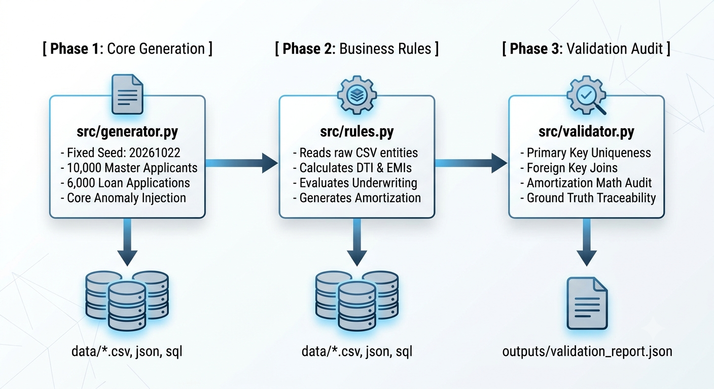

# Deterministic Lending Synthetic Engine & Integrity Auditor

**Project**: `lending-synthetic-engine`  
**Challenge**: YottaFlex AI Forward Deployed Engineer (72-Hour Challenge)  
**Author / Engineer**: Harsh  
**Fixed Random Seed**: `20261022`  
**Development Note**: *The architectural design, domain rules, data model, and anomaly specifications were fully engineered and defined by me (Harsh). The code implementation was generated with AI assistance.*

---

## 📌 Executive Summary

The **Deterministic Lending Synthetic Engine** is a high-performance, decoupled synthetic data generation, derived analytics, and integrity auditing pipeline. It models an end-to-end retail lending ecosystem across 10 relational entities, enforcing 100% deterministic reproducibility via seed `20261022`.

The engine features a strict separation of concerns:
1. **Core Generation (`generator.py`)**: Produces raw operational master/transaction baseline tables and programmatically injects isolated negative edge cases.
2. **Business Rules Engine (`rules.py`)**: Computes downstream financial analytics (DTI, disposable income, compounding EMIs, underwriting decision citations, and month-by-month repayment amortization schedules).
3. **Automated Auditor (`validator.py`)**: Audits primary key uniqueness, foreign key referential integrity, amortization schedule math reconciliation, and ground-truth anomaly verification.
4. **Multi-Format Export**: Serializes all 10 relational tables into **CSV**, **JSON**, and ANSI **SQL DDL + INSERT** script (`data/lending_seed_data.sql`).

---

## 🏗️ System Architecture & Workflow



---

## 🛠️ Quick Start & Execution Guide

### Prerequisites
* Python 3.9+
* Recommended: Virtual Environment (`venv`)

### 1. Installation & Environment Setup
```bash
# Clone the repository
git clone https://github.com/your-username/lending-synthetic-engine.git
cd lending-synthetic-engine

# Create and activate virtual environment
python3 -m venv venv
source venv/bin/activate  # On Windows: venv\Scripts\activate

# Install dependencies
pip install -r requirements.txt
```

### 2. Single-Command Execution
Execute the entire generation, analytics, auditing, and double-run reproducibility verification suite with a single command:
```bash
python3 main.py
```

### 3. Execution Data Output Note
* Multi-format exports (`.csv`, `.json`, `.sql`) are written directly to `data/`.
* Audit summaries are generated in `outputs/validation_report.json`.
* Schema definitions are archived in `outputs/schema.json`.
* *Note on Large Files*: If files in the `data/` folder are compressed for Git storage limits, extract `data.zip` into the project root directory prior to executing standalone verification scripts.

---

## 📑 Data Dictionary (10 Relational Entities)

### 1. Core Baseline Operational Entities (`generator.py`)

#### `loan_products` (Core Dimension)
* `product_id` (VARCHAR, PK): Unique identifier for the loan product (e.g., `PROD-PERSONAL`).
* `product_name` (VARCHAR): Descriptive product title.
* `min_principal` / `max_principal` (DECIMAL): Minimum and maximum allowed loan amounts.
* `min_term_months` / `max_term_months` (INT): Range of valid repayment terms.
* `base_interest_rate` (DECIMAL): Annual nominal interest rate.

#### `applicants` (Core Master)
* `applicant_id` (VARCHAR, PK): Unique applicant reference (`APP-2026-XXXXXX`).
* `first_name` / `last_name` (VARCHAR): Borrower demographic data.
* `dob` (DATE): Date of birth.
* `email` / `phone` (VARCHAR): Contact details.
* `employment_status_flag` (BOOLEAN): Employment indicator.

#### `employments` (Core Detail)
* `employment_id` (VARCHAR, PK): Employment record ID (`EMP-2026-XXXXXX`).
* `applicant_id` (VARCHAR, FK): References `applicants.applicant_id`.
* `employer_name` / `job_title` (VARCHAR): Employment context.
* `tenure_months` (INT): Length of employment.
* `employment_type` (VARCHAR): `FULL_TIME`, `PART_TIME`, `CONTRACT`, or `UNEMPLOYED`.
* `monthly_income` (DECIMAL): Self-reported monthly gross earnings.

#### `income_records` (Core Detail)
* `income_record_id` (VARCHAR, PK): Verified income audit ID (`INC-2026-XXXXXX`).
* `applicant_id` (VARCHAR, FK): References `applicants.applicant_id`.
* `employment_id` (VARCHAR, FK): References `employments.employment_id`.
* `verified_monthly_income` (DECIMAL): Income verified via supporting documents.
* `verification_source` (VARCHAR): `PAYSLIP`, `TAX_RETURN`, or `BANK_STATEMENT`.

#### `credit_facilities` (Core Detail)
* `facility_id` (VARCHAR, PK): Active liability ID (`CF-2026-XXXXXX-XX`).
* `applicant_id` (VARCHAR, FK): References `applicants.applicant_id`.
* `facility_type` (VARCHAR): `CREDIT_CARD`, `AUTO_LOAN`, or `PERSONAL_LOAN`.
* `current_balance` / `monthly_payment` (DECIMAL): Existing financial obligation amounts.

#### `loan_applications` (Core Transaction)
* `application_id` (VARCHAR, PK): Unique loan application ID (`LOAN-2026-XXXXXX`).
* `applicant_id` (VARCHAR, FK): References `applicants.applicant_id`.
* `product_id` (VARCHAR, FK): References `loan_products.product_id`.
* `requested_principal` (DECIMAL): Requested loan amount.
* `requested_term_months` (INT): Requested repayment duration in months.
* `application_status` (VARCHAR): `SUBMITTED`, `APPROVED`, `REJECTED`, or `DISBURSED`.

#### `documents` (Core Detail)
* `document_id` (VARCHAR, PK): Compliance document upload ID (`DOC-LOAN-...`).
* `application_id` (VARCHAR, FK): References `loan_applications.application_id`.
* `document_type` (VARCHAR): `ID_PROOF`, `INCOME_PROOF`, or `BANK_STATEMENT`.
* `verification_status` (VARCHAR): Verification state.

---

### 2. Derived Analytics & Risk Entities (`rules.py`)

#### `affordability_checks` (Derived Risk Analytics)
* `check_id` (VARCHAR, PK): Affordability audit reference (`AFF-LOAN-...`).
* `application_id` (VARCHAR, FK): References `loan_applications.application_id`.
* `gross_monthly_income` (DECIMAL): Aggregated verified monthly income.
* `total_existing_monthly_debt` (DECIMAL): Sum of existing credit facility payments.
* `proposed_emi` (DECIMAL): Calculated Equated Monthly Installment.
* `dti_ratio` (DECIMAL): Debt-to-Income ratio ($\frac{\text{Total Debt}}{\text{Gross Income}}$).
* `disposable_income` (DECIMAL): Net disposable income after debt servicing.
* `affordability_passed` (BOOLEAN): `True` if $\text{DTI} \le 50\%$ and $\text{Disposable Income} \ge \text{₹5,000}$.

#### `decisions` (Derived Underwriting)
* `decision_id` (VARCHAR, PK): Decision record ID (`DEC-LOAN-...`).
* `application_id` (VARCHAR, FK): References `loan_applications.application_id`.
* `decision_outcome` (VARCHAR): `APPROVED` or `REJECTED`.
* `rule_citations` (TEXT): Array of triggered policy decision rules.

#### `repayment_schedules` (Derived Amortization)
* `schedule_id` (VARCHAR, PK): Monthly schedule line ID (`SCH-LOAN-...`).
* `application_id` (VARCHAR, FK): References `loan_applications.application_id`.
* `installment_number` (INT): Month index ($1 \dots N$).
* `due_date` (DATE): Payment due date.
* `principal_component` (DECIMAL): Portion applied to principal reduction.
* `interest_component` (DECIMAL): Portion applied to interest balance.
* `total_installment_amount` (DECIMAL): Total monthly installment payment.
* `ending_balance` (DECIMAL): Remaining principal after installment.

---

## 🎯 Mandatory Edge Case Anomalies (`ground_truth.csv`)

The generator programmatically injects 5 negative test edge cases isolated in `ground_truth.csv` without cross-contaminating standard baseline operations:

1. **`TERM_OUTSIDE_PRODUCT_RANGE`**: Requested application terms intentionally modified to exceed maximum product boundaries (e.g., 120 months for a 60-month personal loan).
2. **`SCHEDULE_RECONCILIATION_MISMATCH`**: Injected rounding or component mismatches where principal + interest components differ from total installment sums.
3. **`PREMATURE_DECISION`**: Underwriting decisions logged prior to completion of mandatory affordability checks.
4. **`INCOME_SOURCE_CONFLICT`**: Verified income records reflecting a $>60\%$ reduction relative to claimed employment earnings.
5. **`DUPLICATE_APPLICATION_DISBURSED_TWICE`**: Duplicate application IDs processed and disbursed twice across system transactions.

---

## 🔍 Validation Suite & Audit Reports

Running `validator.py` or `main.py` performs automated integrity checks:
* **Primary Key Uniqueness**: Verifies 0 duplicate PKs across all 10 entities.
* **Referential Foreign Key Joins**: Confirms 100% of foreign keys resolve to valid parent table records.
* **Amortization Reconciliation**: Audits 500,000+ schedule lines for mathematical balance consistency.
* **Ground Truth Verification**: Maps labeled anomalies in `ground_truth.csv` against source entity records.

Outputs are written to `outputs/validation_report.json`:
```json
{
  "total_applicants": 10000,
  "total_applications": 6020,
  "checks_passed": true,
  "violations_found": [],
  "schedule_reconciliation_errors": 0,
  "ground_truth_audited": 120
}
```

---

## 📜 Source Manifest & Generation Assumptions

* **Fixed Random Seed**: `20261022` enforced at entry point across `random` and `numpy`.
* **Geography & Demographics**: Realistic name distributions, employment types, and income ranges calibrated for modern retail lending analysis.
* **Underwriting Policy**: Standard $50\%$ DTI cap with minimum monthly disposable buffer threshold.
* **Amortization Standard**: Monthly compounding Equated Monthly Installment (EMI) formula with terminal principal adjustment.